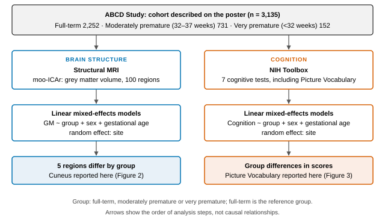
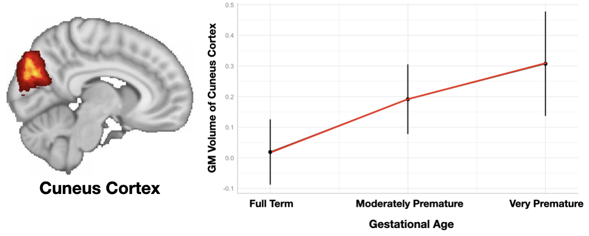
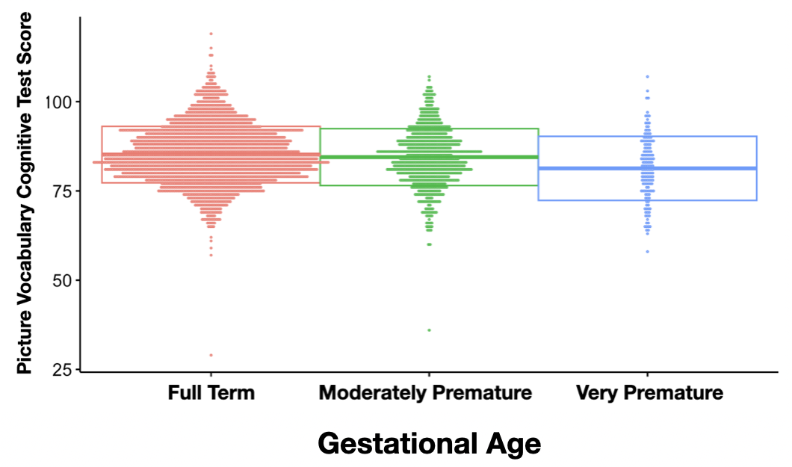

<section class="abstract" markdown="1">

## Abstract

**Background.** Preterm birth is associated with later differences in brain structure and cognition, but less is known about how these differences relate to each other in adolescence.

**Methods.** We used structural MRI and cognitive data from the Adolescent Brain Cognitive Development (ABCD) Study. The study cohort comprised 3,135 adolescents grouped as full-term (n = 2,252), moderately premature (32–37 weeks; n = 731) or very premature (<32 weeks; n = 152). Grey matter (GM) volume was estimated for 100 regions with moo-ICAr, and cognition was assessed with the NIH Toolbox. Linear mixed-effects models with sex and gestational age as fixed effects and site as a random effect compared each premature group with the full-term group.

**Results.** Five GM regions differed by group. Cuneus GM volume was higher in moderately premature (t = 4.36) and very premature (t = 3.84) adolescents than in full-term adolescents. Picture Vocabulary scores, a measure of receptive vocabulary, were lower in both groups (t = −3.13 and t = −5.59).

**Conclusions.** Adolescents born preterm differed from full-term peers in both cuneus GM volume and receptive vocabulary. These cross-sectional associations identify the cuneus as a candidate region for longitudinal work on how preterm birth relates to brain structure and language outcomes.

</section>

## 1. Introduction

Preterm birth, defined as birth before 37 completed weeks of gestation, affected an estimated 13.4 million babies in 2020, more than 1 in 10 births worldwide [1]. Full term is 39 0/7 through 40 6/7 weeks [2]. On average, school-aged children born preterm score lower on cognitive tests than children born at term, and the size of this difference is proportional to gestational age [3].

Structural MRI studies show that these cognitive differences are accompanied by differences in brain structure. In a voxel-based morphometry study of 218 very preterm adolescents and 128 controls, very preterm adolescents showed reduced GM in some regions, including the cuneus, and increased GM in others. Several of these differences were associated with gestational age and with neurodevelopmental outcome [4]. In the ABCD Study, lower gestational age was associated with graded reductions in cognitive performance and with smaller cortical volumes in a range of regions [5].

The cuneus lies on the medial surface of the occipital lobe and forms part of the visual cortex. This report examines whether adolescents born moderately or very preterm differ from full-term peers in cuneus GM volume and in receptive vocabulary, using ABCD data.

## 2. Methods

### 2.1 Data and participants

Data came from the ABCD Study, a 21-site U.S. cohort that recruited more than 10,000 children aged 9–10 years and follows them through adolescence, with imaging protocols harmonized across sites [6]. Participants were grouped by gestational age as full-term, moderately premature (32–37 weeks) or very premature (<32 weeks). Table 1 describes the cohort.

**Table 1.** Study cohort by gestational group.

| Group | n | Male, n (%) | Female, n (%) |
| :-- | --: | --: | --: |
| Full-term | 2,252 | 1,187 (52.7) | 1,065 (47.3) |
| Moderately premature (32–37 weeks) | 731 | 401 (54.9) | 330 (45.1) |
| Very premature (<32 weeks) | 152 | 77 (50.7) | 75 (49.3) |
| Total | 3,135 | 1,665 (53.1) | 1,470 (46.9) |

### 2.2 Structural MRI

GM volume was estimated from structural MRI for 100 regions using moo-ICAr. Figure 1 summarizes the analysis workflow.

<figure class="narrow">

<figcaption><b>Figure 1.</b> Analysis workflow. Schematic of the steps used in this study: grey matter volume and NIH Toolbox scores from the ABCD cohort were each compared across gestational groups with linear mixed-effects models. The schematic contains no data. Image preprocessing steps are not depicted.</figcaption>
</figure>

### 2.3 Cognition

Cognition was assessed with seven tests from the NIH Toolbox, which forms part of the ABCD neurocognition battery [7]. This report focuses on the Picture Vocabulary Test, in which participants hear a word and select the matching picture from four options. The test measures receptive vocabulary, a language ability, and does not require reading or writing [8].

### 2.4 Statistical analysis

Group differences were tested with linear mixed-effects models of the form *outcome ~ group + sex + gestational age*, with site as a random effect. The full-term group was the reference. Models were fitted for regional GM volume and for cognitive scores, identifying regions and tests that differed by group.

## 3. Results

Five of the 100 GM regions showed significant group differences. The cuneus is reported here (Figure 2). Picture Vocabulary results are shown in Figure 3. Table 2 lists the four comparisons with the full-term group.

**Table 2.** Differences from the full-term group in cuneus GM volume and Picture Vocabulary score.

| Outcome | Group | t | p |
| :-- | :-- | --: | --: |
| Cuneus GM volume | Moderately premature | 4.36 | < 1.3 × 10−5 |
| | Very premature | 3.84 | < 1.2 × 10−4 |
| Picture Vocabulary | Moderately premature | −3.13 | < 1.77 × 10−3 |
| | Very premature | −5.59 | < 2.45 × 10−8 |

### 3.1 Cuneus grey matter volume

Cuneus GM volume was higher in moderately premature and very premature adolescents than in full-term adolescents (Table 2). In the plotted group values, the very premature group had the highest cuneus GM volume and the full-term group the lowest (Figure 2).

<figure>

<figcaption><b>Figure 2.</b> Cuneus grey matter volume by gestational group. Left: location of the cuneus region (highlighted) on a medial sagittal brain image, posterior to the left. Right: cuneus GM volume for each group, with points and vertical bars as plotted on the source poster. Reproduced from the poster.</figcaption>
</figure>

### 3.2 Picture Vocabulary

Picture Vocabulary scores were lower in moderately premature and very premature adolescents than in full-term adolescents (Table 2). The difference was larger for the very premature group (Figure 3).

<figure class="narrow">

<figcaption><b>Figure 3.</b> Picture Vocabulary scores by gestational group. Each point is one participant’s score; box outlines are drawn as on the source poster. Reproduced from the poster.</figcaption>
</figure>

## 4. Discussion

Adolescents born preterm had higher cuneus GM volume and lower receptive vocabulary scores than full-term peers. The vocabulary difference is consistent with meta-analytic evidence of lower cognitive scores after preterm birth, and it was larger in the very premature group [3].

The direction of the GM finding differs from some earlier work. Nosarti and colleagues reported reduced cuneus GM in very preterm adolescents [4], and Ma and colleagues found that lower gestational age in ABCD was associated with smaller cortical volumes [5]. Differences in method may contribute, including component-based versus atlas-based GM estimates, different gestational groupings and different covariates. Comparing these approaches on the same data would help determine whether the difference is methodological.

Higher cuneus GM volume could reflect differences in the timing of cortical maturation, since cortical volume generally declines across adolescence [9]. Other explanations are equally plausible, and higher volume does not by itself indicate either an advantage or delayed development. Distinguishing these possibilities requires repeated measures across development.

Although the Picture Vocabulary Test presents pictures, it measures receptive vocabulary rather than visual processing [8]. The co-occurrence of a visual-cortex difference and a vocabulary difference therefore does not show that the vocabulary difference is visual in origin. Measures that separate visual processing from language would be needed to test that idea.

The poster also reported an exploratory mediation estimate, in which cuneus GM volume accounted for 4.1% of the association between gestational age and Picture Vocabulary performance. That estimate requires evaluation using the full model output and longitudinal validation, so this report does not interpret it. Single-timepoint data cannot establish that a brain difference lies on a pathway between gestational age and cognition.

## 5. Limitations

The study is observational and cross-sectional, so the associations reported here do not establish causation or developmental change. The models adjusted for sex, gestational age and site; other factors that differ with preterm birth, such as birth weight, multiple birth, neonatal complications and socioeconomic circumstances, may contribute to the observed differences. The very premature group was the smallest, and births before 28 weeks were not analysed separately. Of the five GM regions that differed by group and the seven cognitive tests, this report presents only the cuneus and Picture Vocabulary, so it does not describe the full pattern of results. The findings describe group-level differences in a research cohort and are not suitable for diagnosis or prediction in individuals.

## 6. Conclusion

In the ABCD Study, adolescents born moderately or very preterm had higher cuneus GM volume and lower receptive vocabulary scores than full-term peers. These cross-sectional associations motivate longitudinal work on how preterm birth relates to the cuneus and to language outcomes, and on whether the two are linked.

## Acknowledgements

This research was supported by National Institutes of Health grants R01MH130595 and R34DA061483. Data were obtained from the Adolescent Brain Cognitive Development (ABCD) Study.

## References

<ol class="references">
<li>World Health Organization. Preterm birth. Fact sheet; 10 May 2023. https://www.who.int/news-room/fact-sheets/detail/preterm-birth</li>
<li>American College of Obstetricians and Gynecologists Committee on Obstetric Practice; Society for Maternal-Fetal Medicine. ACOG Committee Opinion No. 579: Definition of term pregnancy. <i>Obstet Gynecol</i>. 2013;122(5):1139–1140.</li>
<li>Bhutta AT, Cleves MA, Casey PH, Cradock MM, Anand KJ. Cognitive and behavioral outcomes of school-aged children who were born preterm: a meta-analysis. <i>JAMA</i>. 2002;288(6):728–737. doi:10.1001/jama.288.6.728</li>
<li>Nosarti C, Giouroukou E, Healy E, et al. Grey and white matter distribution in very preterm adolescents mediates neurodevelopmental outcome. <i>Brain</i>. 2008;131(Pt 1):205–217. doi:10.1093/brain/awm282</li>
<li>Ma Q, Wang H, Rolls ET, et al. Lower gestational age is associated with lower cortical volume and cognitive and educational performance in adolescence. <i>BMC Med</i>. 2022;20(1):424. doi:10.1186/s12916-022-02627-3</li>
<li>Casey BJ, Cannonier T, Conley MI, et al. The Adolescent Brain Cognitive Development (ABCD) study: imaging acquisition across 21 sites. <i>Dev Cogn Neurosci</i>. 2018;32:43–54. doi:10.1016/j.dcn.2018.03.001</li>
<li>Luciana M, Bjork JM, Nagel BJ, et al. Adolescent neurocognitive development and impacts of substance use: overview of the adolescent brain cognitive development (ABCD) baseline neurocognition battery. <i>Dev Cogn Neurosci</i>. 2018;32:67–79. doi:10.1016/j.dcn.2018.02.006</li>
<li>Gershon RC, Slotkin J, Manly JJ, et al. IV. NIH Toolbox Cognition Battery (CB): measuring language (vocabulary comprehension and reading decoding). <i>Monogr Soc Res Child Dev</i>. 2013;78(4):49–69. doi:10.1111/mono.12034</li>
<li>Tamnes CK, Herting MM, Goddings AL, et al. Development of the cerebral cortex across adolescence: a multisample study of inter-related longitudinal changes in cortical volume, surface area, and thickness. <i>J Neurosci</i>. 2017;37(12):3402–3412. doi:10.1523/JNEUROSCI.3302-16.2017</li>
</ol>
